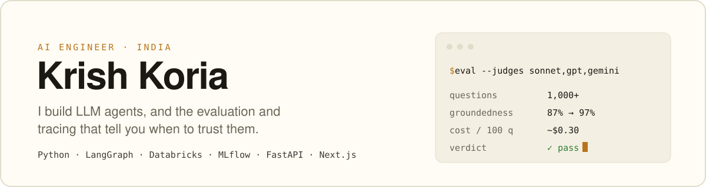

<picture>
  <source media="(prefers-color-scheme: dark)" srcset="./assets/banner-dark.svg">
  
</picture>

  
  
  
  

**Open to AI engineering roles** (India or remote). I like the part of AI work most teams skip: measuring whether the agent is actually right, and making that check cheap enough to run every day.

## What I've shipped at work

**AI Engineer, [Abacus Insights](https://www.abacusinsights.com)** · Feb – Oct 2026 · healthcare payment integrity

- **AI governance pipeline.** Scores an NL2SQL agent on syntax, hallucination and groundedness across 1,000+ questions for about $0.30 per 100. Generates up to 10 variations per seed question, traces every run in MLflow and serves results through FastAPI.
- **Three-model judge council.** Claude Sonnet, GPT and Gemini vote on whether the generated SQL answers the question. I traced false failures to truncated evidence, removed it, and measured groundedness went from 87% to 97%.
- **Config-as-code CLI.** Promotes agent configurations across 10 environments from one YAML manifest, in parallel, with versioned and logged applies. Promotion went from hours to seconds.
- **As an intern:** RxNorm ingestion with checksum verification that triggers PySpark jobs on Databricks, and the RAG layer of a fraud-detection platform (Llama 3.3 70B, vector DB, XGBoost).

**Software Engineering Intern, [Dobr.AI](https://dobr.ai)** · Aug – Oct 2025

- Built live interview recording with WebRTC and chunked S3 uploads, so reviewers could watch right after a session and dropped connections kept partial recordings. Cut video storage by 30%.

That work lives in private repos, which is why my public graph goes quiet mid-2026.

## Things I've built

<table>
<tr>
<td width="50%" valign="top">

### [AutoWeave](https://github.com/KrishKoria/AutoWeave)

Drag-and-drop workflow automation with AI steps (OpenAI, Anthropic, Gemini), webhook and HTTP triggers, and live execution status.

`Next.js` `TypeScript` `Tailwind`

[Live](https://auto-weave.vercel.app/) · [Case study](https://www.krishkoria.com/work/autoweave)

</td>
<td width="50%" valign="top">

### [Axiom](https://github.com/KrishKoria/Axiom)

A browser IDE where you build with Claude: conversational coding, inline suggestions, live preview, an integrated terminal and GitHub sync.

`Next.js` `TypeScript` `Claude API`

[Repo](https://github.com/KrishKoria/Axiom)

</td>
</tr>
<tr>
<td width="50%" valign="top">

### [Meet.AI](https://github.com/KrishKoria/Meet.AI)

Video calls with an AI agent in the room. Live transcription during the call, then summaries and a searchable transcript you can chat with.

`Next.js` `Stream Video SDK` `TypeScript`

[Live](https://meet-ai-three-alpha.vercel.app/) · [Case study](https://www.krishkoria.com/work/meet-ai)

</td>
<td width="50%" valign="top">

### [HarmonyAI](https://github.com/KrishKoria/HarmonyAI)

Text-to-music generation with ACE-Step, Qwen2-7B and SDXL-Turbo running on serverless GPUs.

`Next.js` `FastAPI` `PostgreSQL` `AWS S3`

[Live](https://harmony-ai-ten.vercel.app/) · [Case study](https://www.krishkoria.com/work/harmonyai)

</td>
</tr>
</table>

**Also:**
[Webhook Delivery Service](https://github.com/KrishKoria/Webhook-Delivery-Service) (Go, Gin, Redis: HMAC-verified ingestion, async retries, dead-letter queue) ·
[What's This Sound?](https://whats-this-sound.vercel.app/) (CNN audio classifier with visualizations) ·
[Metroidvania](https://github.com/KrishKoria/Metroidvania) (a Godot 4 platformer, for fun)

## Stack

Plus Databricks, Unity Catalog, Delta Lake, PySpark, MLflow, LangGraph / LangChain and WebRTC.

## Outside work

- 2nd runner-up, Odoo Hackathon 2025, out of 19,000+ participants
- Finalist, Brain it On 2.0 (national hackathon), 2024
- Technical Head, R.O.F.I.E.S Robotics Club, IIIT Pune: led 20+ members, ran 10+ workshops for 100+ students
- B.Tech in Computer Science, [IIIT Pune](https://www.iiitp.ac.in/), 2022 – 2026

<picture>
  <source media="(prefers-color-scheme: dark)" srcset="https://github-readme-stats-sooty-phi.vercel.app/api?username=KrishKoria&show_icons=true&include_all_commits=true&count_private=true&hide_border=true&bg_color=0a0905&title_color=e8a33d&text_color=f4efe1&icon_color=e8a33d">
  
</picture>

If you're hiring for agents, evals or LLM platform work, [email me](mailto:krishkoria2004@gmail.com) or [book a call](https://cal.com/krishkoria).
